# Wingly ☁️✈️

A small SwiftUI flight app: log in, search flights, keep recent searches, save favorite flights and view flight details. Built for the Swift take-home assignment.

- **Swift 6** language mode with complete strict concurrency checking
- **SwiftUI** + **Observation** (`@Observable`)
- **Swift Concurrency** (`async`/`await`, actor isolation, `Sendable` services)
- **SwiftData** for persistence
- **MVVM** architecture (explained below)
- No third-party dependencies

## Contents

- [Features](#features)
- [Requirements](#requirements)
- [Setup and running](#setup-and-running)
- [Architecture](#architecture)
- [Mock data](#mock-data)
- [Testing](#testing)
- [Trade-offs and decisions](#trade-offs-and-decisions)
- [Project structure](#project-structure)
- [Screenshots](#screenshots)

## Features

### Required

| Area | What's there |
| --- | --- |
| **Login** | Email/username + password form. Authentication is mocked. The app shows the login screen until a user is signed in and remembers the session between launches. |
| **Home** | Search form (origin, destination, departure date, arrival date, Search button) with recent searches below it. Origin and destination can't be the same, and the arrival date can't be before departure. |
| **Search results** | Separate screen listing matching flights grouped by day. Each card shows flight number, airline, times, duration and status. Flights can be favorited from the list. Tapping a card opens Flight Details. |
| **Recent searches** | Shown as `TIA → FCO · 12 Oct – 15 Oct`. Newest first, limited to the last 10, repeated searches move to the top instead of duplicating. Tapping one prefills the form. Persisted with SwiftData. |
| **Favorite flights** | Own tab. Remove by swipe or Edit. Persisted with SwiftData. |
| **Flight details** | Departure/arrival airports, dates and times, aircraft, terminal, gate and status. Reachable from both Search Results and Favorites. |
| **Navigation** | Tab bar with Home, Favorites, Profile and More. Each tab has its own `NavigationStack` with proper titles and back navigation (Home → Results → Details, Favorites → Details, More → sub-pages). |
| **Profile** | User info, dark mode toggle and logout (with confirmation). |
| **More** | Settings, Help, About and Contact, each leading to a placeholder screen. |
| **Theming** | Light and dark themes applied to every screen including navigation bars and the tab bar. Follows the system appearance by default and remembers the user's choice. |

### Bonus

- **Pull-to-refresh** on search results.
- **Airport autocomplete** for origin and destination (matches IATA code, city, airport name or country) plus a swap button.
- **Unit tests** for view models, persistence, the flight generator and presentation logic (Swift Testing).
- **Live Activity** for a favorited flight (ActivityKit + WidgetKit extension) on the Lock Screen and in the Dynamic Island, with simulated status updates.
- **Animations and polish**:
  - Animated splash screen: the cloud mascot wiggles, puffs, and a little plane loops out of it.
  - A cloud mascot (the same drawing as the app icon) appears in empty states, loading states and the login screen, with moods (happy, sleepy, confused).
  - Boarding-pass style Flight Details header with a route arc, a plane positioned by flight progress and a live countdown ("Departs in 2h 15m", "In the air · lands in 45m").
  - Time-of-day greeting on Home, drifting background clouds, heart burst when favoriting, haptics, rounded typography and a custom app icon with a dark variant.
  - All looping animations respect **Reduce Motion**.
- **Per-user data**: favorites and recent searches belong to the signed-in user, so switching accounts shows each user only their own data.

## Requirements

- Xcode 16 or later for the Swift 6 toolchain (developed and tested with Xcode 27.1)
- iOS 17.0+ deployment target (SwiftData and Observation)
- [XcodeGen](https://github.com/yonaskolb/XcodeGen) only if you change `project.yml` — the generated `FlightApp.xcodeproj` is committed

## Setup and running

1. Clone the repository and open the project:

   ```sh
   git clone https://github.com/notDejv/flightApp.git
   cd flightApp
   open FlightApp.xcodeproj
   ```

2. Select the **FlightApp** scheme and an iPhone simulator, then press **⌘R**.

3. Log in with **any username and a password of at least 4 characters** (for example `jane.doe` / `password`). This is shown on the login screen as well.

### Running on a device

The project is signed with automatic signing. To run on your own iPhone, change the team for both the **FlightApp** and **FlightWidget** targets under *Signing & Capabilities* (or change `DEVELOPMENT_TEAM` in `project.yml` and regenerate). If the bundle identifier is taken, change `com.dejv.flightApp` and keep the widget as `<app id>.widget`.

### Regenerating the project

The Xcode project is generated from `project.yml`:

```sh
brew install xcodegen
xcodegen generate
```

### Trying the Live Activity

Favorite a flight, open its details and tap **Track on Lock Screen**. The status then advances (boarding → departed → landed) every 20 seconds. Lock the device or simulator to see it on the Lock Screen; on devices with a Dynamic Island it also shows there.

## Architecture

The app uses **MVVM** on top of SwiftUI's Observation framework, with a small composition root and protocol-based services.

```
 Views (SwiftUI)
   │  own / observe
   ▼
 ViewModels (@Observable, @MainActor)      Shared stores (@Observable, @MainActor)
   │  call                                   SessionStore · ThemeStore · FavoritesStore
   ▼                                           │
 Services (protocols, Sendable)            Repositories (protocols, @MainActor)
   AuthService · FlightService               RecentSearchRepository · FavoritesRepository
   AirportCatalog · LiveActivityService        │
                                               ▼
                                             SwiftData (ModelContainer)
```

### Layers

- **Views** are thin. They lay out state and forward user intent. Screens with real logic own their view model through `@State`.
- **View models** (`HomeViewModel`, `SearchResultsViewModel`, `LoginViewModel`) are `@Observable` and `@MainActor`. They hold screen state, validation and async loading, and depend only on protocols, which keeps them unit-testable without UI.
- **Shared stores** hold state that several screens read:
  - `SessionStore`: the signed-in user.
  - `ThemeStore`: system / light / dark preference.
  - `FavoritesStore`: favorites. It's shared so that favoriting a flight in Search Results immediately shows up in the Favorites tab and its badge.

  They are injected with SwiftUI's `.environment(_:)`.
- **Services** are `Sendable` protocols (`AuthService`, `FlightService`, `AirportCatalog`) with mock implementations. A real backend would replace the mock types without touching view models.
- **Repositories** wrap SwiftData (`SwiftDataRecentSearchRepository`, `SwiftDataFavoritesRepository`) and contain the persistence rules: newest first, de-duplication, the 10-item limit and per-user scoping.
- **`AppDependencies`** is the composition root. It builds the model container, services and stores once at launch. It also keeps the favorites store pointed at the current user's data whenever someone signs in or out.

### Concurrency

- Strict concurrency is set to `complete` under Swift 6.
- UI-facing types (view models, stores, repositories) are `@MainActor`. Services are `Sendable` value types with `async` methods.
- Loading uses `.task` and `.refreshable`. Cancellation is handled explicitly: a cancelled search doesn't turn into an error state.
- `ActivityKit`'s `Activity` isn't `Sendable`, so `LiveActivityService` looks activities up and updates them inside `nonisolated` helpers. They never cross an actor boundary.

### Navigation

Each tab owns a `NavigationStack` with value-based navigation (`NavigationLink(value:)` + `navigationDestination(for:)`). Home uses a `NavigationPath` so the Search button can push results programmatically after saving the search.

### Theming

`ThemeStore` stores `system`, `light` or `dark` in `UserDefaults` and applies it through `UIWindow.overrideUserInterfaceStyle`. Doing it at the window level means navigation bars, the tab bar and system sheets all follow the theme. Switching back to *Match System* also takes effect immediately, which `preferredColorScheme(nil)` doesn't always do. Colors come from a small `Palette` with light/dark variants taken from the app icon.

## Mock data

Search results come from `MockFlightService`, backed by `MockFlightGenerator`:

- For any route and day it generates 2–4 flights from a fixed list of real airlines and aircraft. A seeded random number generator is used, with the seed taken from a stable hash of the route and date.
- The same search therefore always returns the **same flights with the same IDs**, so favorites keep matching results across launches. No large JSON fixture is needed, and any airport pair works.
- Flight duration depends on the route and is symmetric in both directions.
- Status is based on the current time (landed / departed / boarding), with a small chance of delayed or cancelled.
- The service adds ~600 ms of simulated latency.

Airports (about 35, focused on Europe and Albania's connections) are loaded from `Resources/airports.json`.

**Search semantics:** the departure and arrival dates are treated as a date range. Results include flights departing on any day from the departure date through the arrival date, capped at 14 days.

## Testing

Run the tests from Xcode with **⌘U**, or from the command line:

```sh
xcodebuild test -scheme FlightApp -destination 'platform=iOS Simulator,name=iPhone 17 Pro'
```

The suite uses **Swift Testing** and in-memory SwiftData containers, so tests don't touch the app's real store. It covers:

- **Persistence:** recent searches are newest first, de-duplicated, limited per user and isolated per user. Favorites add and remove correctly, and the same flight can be favorited by different users. Data survives new repository instances. Session and theme persistence.
- **View models:** search form validation (same airport, date order), autocomplete clearing a selection, saving and prefilling recent searches, swapping airports, loading and grouping results, error states, login validation and success.
- **Business logic:** generator determinism, schedule shape and status rules, date-range search and its cap, airport search ranking, flight timeline / countdown text, greeting by time of day, Live Activity status progression.
- **Integration:** favorites follow the signed-in user through `AppDependencies` across logout and login.

## Trade-offs and decisions

- **Mock auth, no Keychain.** There's no token or real credential, so only the signed-in user's profile is stored, in `UserDefaults`. A real implementation would keep a token in the Keychain.
- **Per-user data keyed by username.** Favorites and recent searches carry an `ownerID` (the lowercased username). With a real backend this would be the account ID, and favorites would probably sync from the server.
- **Encoded payloads in SwiftData.** Recent searches and favorites store the criteria / flight as encoded `Data` next to a few indexed fields (`ownerID`, key, timestamp). The app always reads these records back whole and only filters and sorts by those fields, so a full relational model would add mapping code without benefit. The downside is that payload contents can't be queried with predicates.
- **Favorites are snapshots.** A favorite stores the flight as it was when saved. Flight Details derives "upcoming / in the air / landed" from the departure and arrival times, so older favorites still read correctly. A real app would refresh status from the API.
- **Simulated Live Activity updates.** Without a push server, status changes are driven locally by a timer while the app is alive. Production would use ActivityKit push updates over APNs.
- **Window-level theme override** instead of `preferredColorScheme`, for the reasons described under [Theming](#theming).
- **XcodeGen.** `project.yml` keeps the project definition readable and avoids merge conflicts in `project.pbxproj`. The generated project is committed, so reviewers don't need to install anything.
- **iOS 17 minimum.** Required by SwiftData and Observation. Newer APIs are avoided so everything works on iOS 17.

## Project structure

```
FlightApp/
├── App/                 App entry, composition root, root/tab views, splash screen
├── Core/
│   ├── Models/          Airport, Flight, SearchCriteria, User
│   ├── Persistence/     SwiftData entities and repositories
│   ├── Services/        Auth, flights (mock generator), airports, Live Activities
│   ├── Stores/          Session, theme, favorites
│   └── Theme/           Palette, app appearance, sky background
├── Features/
│   ├── Login/  Home/  SearchResults/  FlightDetails/
│   ├── Favorites/  Profile/  More/
│   └── Shared/          Flight card, status badge, cloud mascot, empty/loading states
└── Resources/           Assets (app icon, launch color), airports.json
FlightWidget/            Live Activity UI + shared ActivityAttributes
FlightAppTests/          Swift Testing suite
project.yml              XcodeGen project definition
```

## Screenshots

Taken on an iPhone 17 Pro simulator (iOS 26.5).

| Splash | Login | Home | Autocomplete |
| :---: | :---: | :---: | :---: |
| 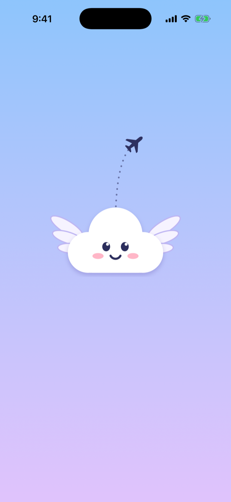 | 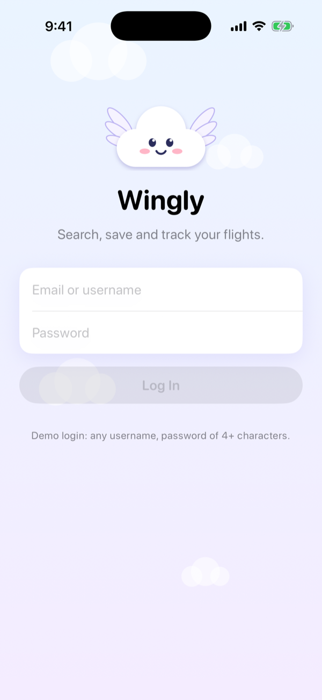 | 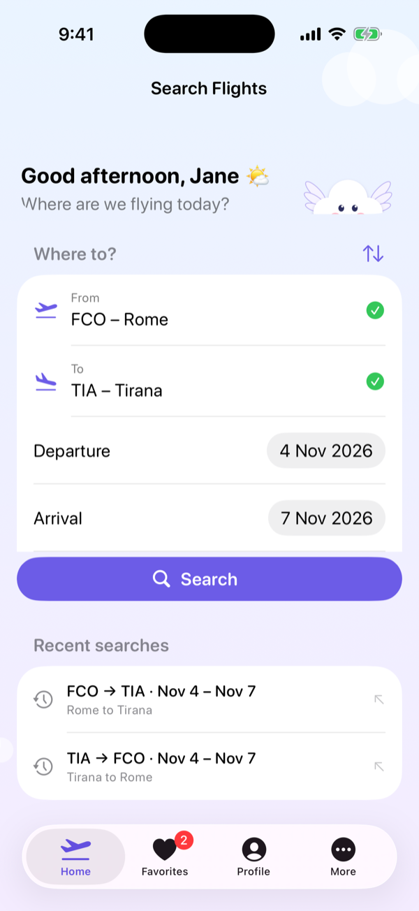 | 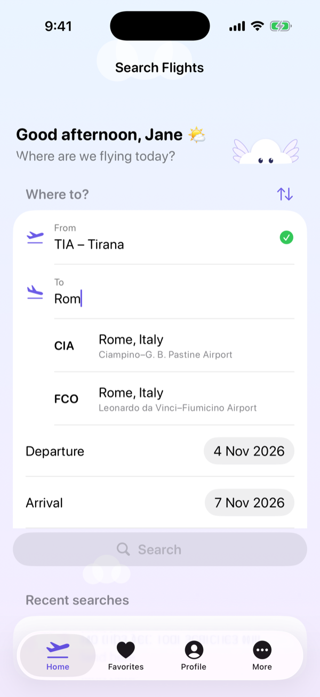 |

| Search results | Flight details | Favorites | Placeholder (More) |
| :---: | :---: | :---: | :---: |
| 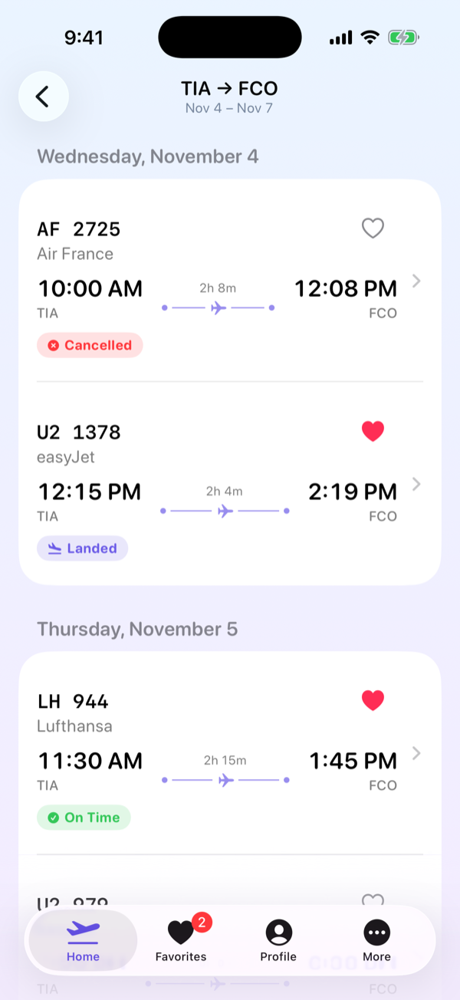 | 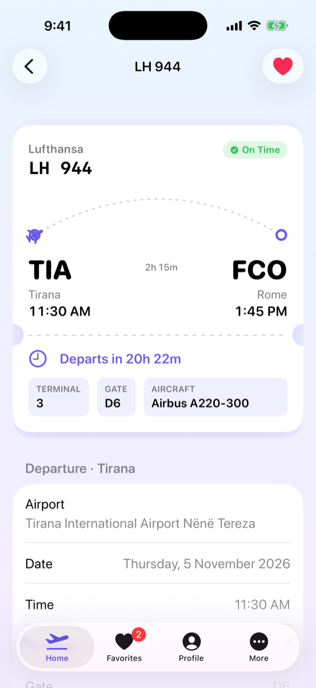 | 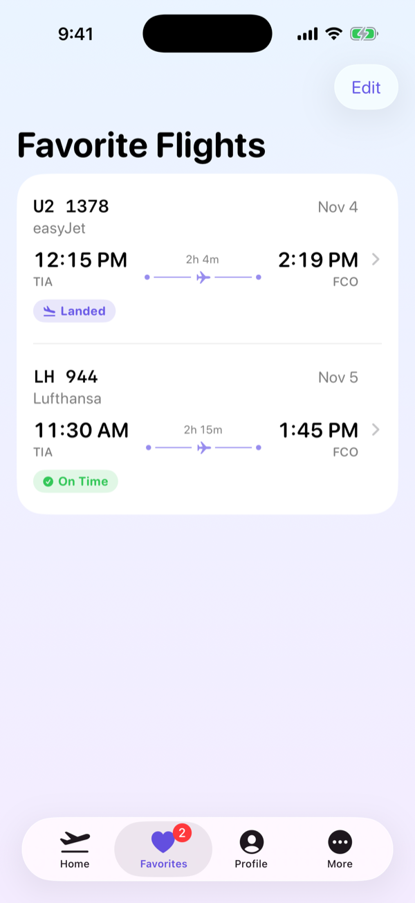 | 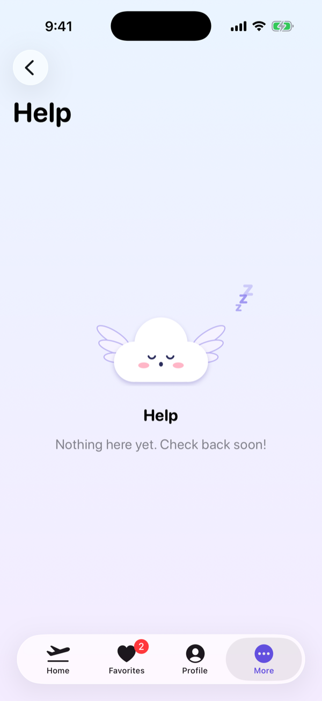 |

| Home (dark) | Results (dark) | Details (dark) | Live Activity |
| :---: | :---: | :---: | :---: |
| 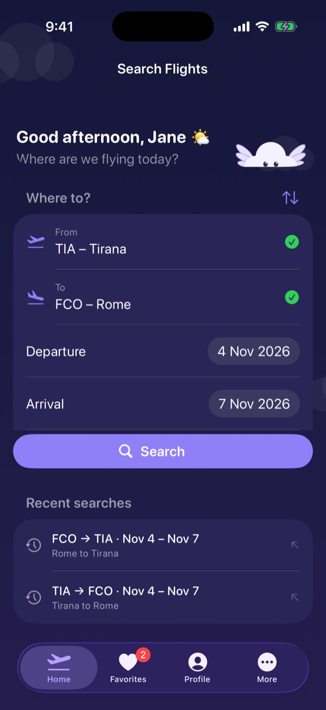 | 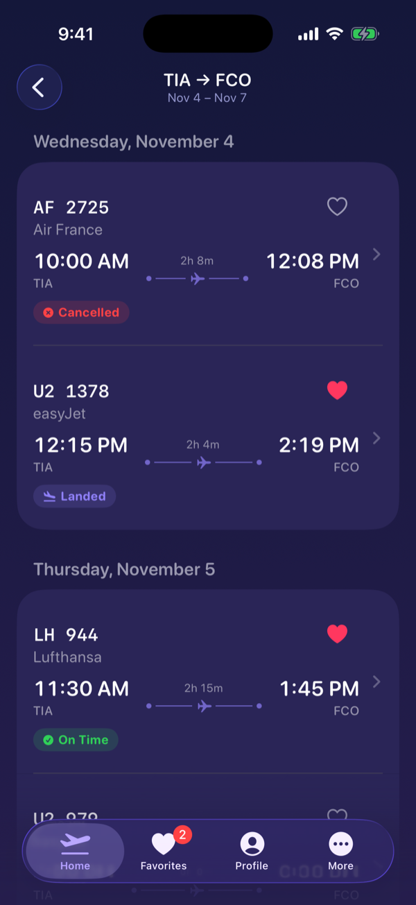 | 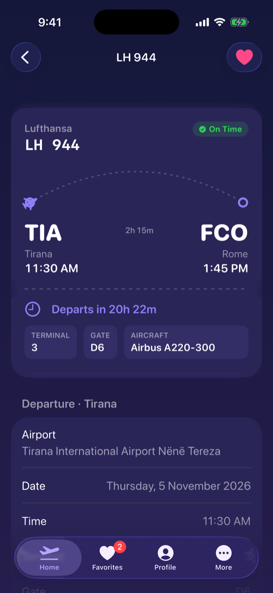 | 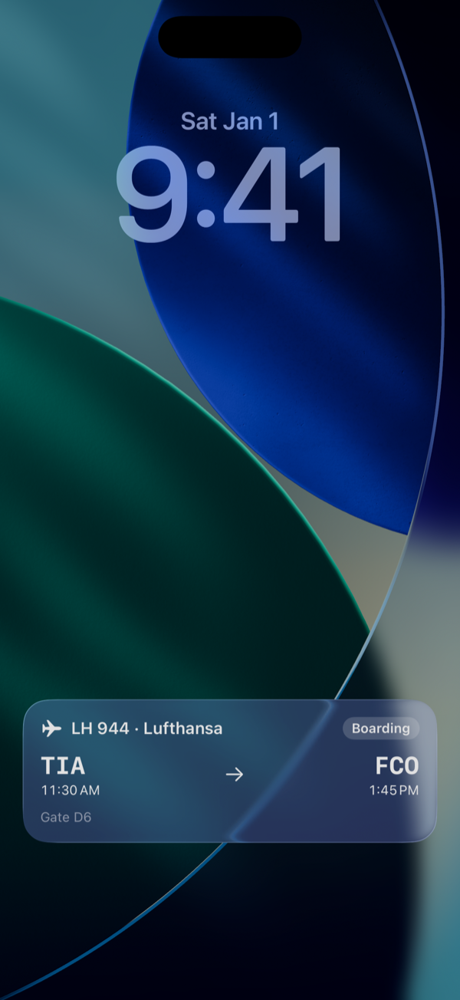 |
